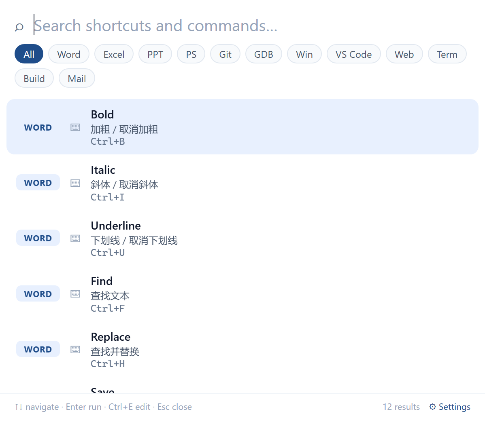
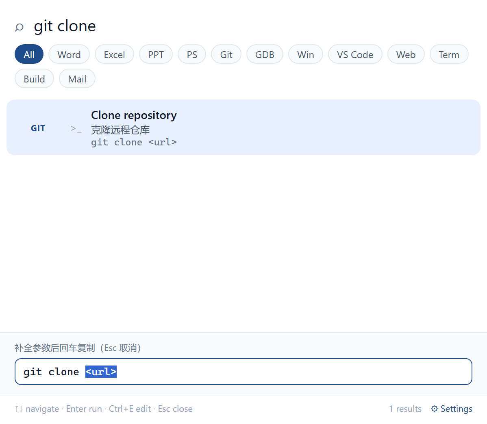

# Shortcut Launcher

> Windows 蹇嵎閿?/ 鍛戒护閫熸煡鍣細`Ctrl+Alt+K` 鍛煎嚭锛岃緭鍏ュ嵆鎼滐紝鍛戒护鑷姩澶嶅埗锛屽揩鎹烽敭閫忔槑娴眰鎻愮ず銆?
[](LICENSE)
[](https://github.com/Neil-Wang-2085/shortcut-launcher/actions/workflows/build.yml)
[](https://marketplace.visualstudio.com/items?itemName=neilwang.shortcut-launcher)


鍐呯疆 **250 鏉?*蹇嵎閿笌鍛戒护锛岃鐩?Office 涓変欢濂椼€丳hotoshop銆丟it銆丟DB銆乄indows銆乂S Code銆丆hrome/Edge銆佺粓绔€丆Make/Make銆丱utlook锛?*姣忔潯閮芥湁涓枃璇存槑**銆?
## 鎴浘

| Launcher | 鍛戒护琛ュ弬 |
|---|---|
|  |  |

| 蹇嵎閿诞灞?| 鍋忓ソ璁剧疆 |
|---|---|
|  |  |

## 涓轰粈涔堝仛杩欎釜

- 涓枃蹇嵎閿祫鏂欏垎鏁ｅ湪鍗氬/琛ㄦ牸閲岋紝涓斿ぇ澶氬彧鏈夎嫳鏂囧悕
- 鐜版湁鍚姩鍣ㄥ亸"鍚姩搴旂敤"锛屽"鏌ュ揩鎹烽敭銆佹妱鍛戒护"鏀寔涓€鑸?- 鎯宠涓€涓?*绂荤嚎銆佷究鎼恒€佸甫涓枃璇存槑銆佽兘琛ュ懡浠ゅ弬鏁?*鐨勫皬宸ュ叿

## 鐗规€?
- **妯＄硦鎼滅储**锛氬璇?AND銆佹寜閿粍鍚堛€佹嫾鍐欏閿欍€佷腑鑻辨贩鍚堛€佷腑鏂?bigram 鍖归厤
- **鍛戒护鍗崇敤**锛氬懡浠ょ粨鏋滃洖杞︾洿鎺ュ鍒讹紱鍚?`<url>` / `<branch>` / `HEAD~N` 鐨勪細鍏堝脊鍑鸿ˉ鍙傜紪杈戞潯
- **蹇嵎閿诞灞?*锛氶€忔槑閿附灞曠ず锛屼笉鎶㈢劍鐐广€侀紶鏍囩┛閫忥紝鑷姩娑堝け锛堟椂闀垮彲閰嶏級
- **甯哥敤浼樺厛**锛氭寜浣跨敤娆℃暟 + 鏈€杩戜娇鐢ㄥ姞鏉冿紙frecency锛夛紝瓒婄敤瓒婇『鎵?- **鑷畾涔夋潯鐩?*锛氳〃鍗曟坊鍔狅紝鎴栧鍏?JSON / CSV / 鏂囨湰
- **鍋忓ソ璁剧疆**锛氬叏灞€鐑敭锛堢偣鍑诲綍鍒讹級銆佸紑鏈鸿嚜鍚€佹诞灞傜鏁?- **杞婚噺甯搁┗**锛氭墭鐩樸€佸崟瀹炰緥銆佺绾胯繍琛岋紝鎻愪緵渚挎惡鐗?- **涓枃璇存槑**锛?50 鏉″唴缃暟鎹叏閮ㄥ甫涓枃鎻忚堪

## VS Code 鎵╁睍

浠撳簱鍐呮彁渚?VS Code 鎵╁睍锛坄vscode-extension/`锛夛紝鍦ㄧ紪杈戝櫒閲屾寜 `Ctrl+Alt+Shift+K` 鎼滅储鍚屼竴濂?250 鏉℃暟鎹細

- 鍛戒护锛氬鍒跺埌鍓创鏉匡紝鎴栦竴閿€屾彃鍏ョ粓绔€?- 蹇嵎閿細鎵撳紑閿附闈㈡澘
- 鐘舵€佹爮鍏ュ彛锛歚鈱?Shortcuts`
- 鏀寔鑷畾涔夊懡浠わ細鎼滅储闈㈡澘搴曢儴 **锛?鏂板鑷畾涔夊懡浠も€?*锛屾垨鍛戒护闈㈡澘 `Shortcut Launcher: Add Custom Command`

瀹夎锛堜簩閫変竴锛夛細

```bash
# 浠?VS Code Marketplace
code --install-extension neilwang.shortcut-launcher

# 鎴栦粠 Releases 涓嬭浇 .vsix
code --install-extension shortcut-launcher-0.1.1.vsix
```

[Marketplace 椤甸潰](https://marketplace.visualstudio.com/items?itemName=neilwang.shortcut-launcher) 路 [鎵╁睍璇存槑](vscode-extension/README.md)

## 涓嬭浇

浠?[Releases](https://github.com/Neil-Wang-2085/shortcut-launcher/releases) 涓嬭浇锛?
- `ShortcutLauncher-x.y.z-portable.exe`锛氫究鎼虹増锛屽弻鍑诲嵆鐢?- `Shortcut.Launcher.Setup.x.y.z.exe`锛氬畨瑁呯増锛堝彲閫夌洰褰曘€佹闈?寮€濮嬭彍鍗曞揩鎹锋柟寮忥級
- `shortcut-launcher-0.1.1.vsix`锛歏S Code 鎵╁睍

> 鏈仛浠ｇ爜绛惧悕锛岄娆¤繍琛屽彲鑳借Е鍙?SmartScreen锛氱偣銆屾洿澶氫俊鎭?鈫?浠嶈杩愯銆嶃€備粙鎰忓彲鑷浠庢簮鐮佹瀯寤恒€?
鏁版嵁鐩綍锛歚%APPDATA%\shortcut-launcher\`

| 鏂囦欢 | 鐢ㄩ€?|
|---|---|
| `config.json` | 鐑敭 / 寮€鏈鸿嚜鍚?/ 娴眰鏃堕暱 |
| `usage.json` | 浣跨敤娆℃暟涓庢渶杩戜娇鐢ㄦ椂闂达紙frecency锛?|
| `user-entries.json` | 鑷畾涔夋潯鐩?|

## 浣跨敤

- `Ctrl+Alt+K` 鍛煎嚭/闅愯棌锛堝彲鍦ㄨ缃噷鏀癸紱鍐茬獊鏃惰嚜鍔ㄥ洖閫€锛?- `鈫慲 `鈫揱 閫夋嫨锛宍Enter` 鎵ц锛宍Esc` 鍏抽棴
- 椤堕儴 chips 鎸夊簲鐢ㄨ繃婊?
鎼滅储璇硶锛?
| 杈撳叆 | 浣滅敤 |
|---|---|
| `word bold` | 澶氳瘝 AND |
| `ctrl b` / `ctrl+b` | 鎸夋寜閿粍鍚堟壘 |
| `app:git rebase` | 闄愬畾搴旂敤 |
| `type:shortcut ctrl` | 鍙悳蹇嵎閿?|
| `tag:rebase` | 鎸夋爣绛捐繃婊?|
| `鍐荤粨绐楁牸` | 涓枃璇存槑鐩存帴鎼?|
| `git 鏀逛綔鑰呭悕瀛梎 | 涓嫳娣峰悎 |

鍛戒护涓庡揩鎹烽敭锛?
- 鍛戒护锛歚Enter` 澶嶅埗锛涘甫鍗犱綅绗︽椂鍏堣ˉ鍙傦紱`Ctrl+E` 鍙紪杈戜换鎰忓懡浠?- 蹇嵎閿細`Enter` 寮瑰嚭閿附娴眰

鑷畾涔夋潯鐩細鎵樼洏 鈫?**Custom Entries鈥?*锛屾垨 launcher 搴曢儴 `鈿?Settings`銆傛敮鎸佽〃鍗曘€丣SON/CSV 鏂囦欢瀵煎叆銆佺矘璐存枃鏈鍏ャ€?
## 鍐呯疆鏁版嵁锛?50 鏉★級

| 鍒嗙被 | 鏉℃暟 | 瑕嗙洊 |
|---|---|---|
| Word / Excel / PPT | 20 / 21 / 17 | 鏍煎紡銆佹煡鎵俱€佸鑸?|
| Photoshop | 25 | 鍥惧眰銆佸彉鎹€佽皟鑹层€佹护闀?|
| Git | 36 | 鎻愪氦銆佸垎鏀€佸彉鍩恒€佹敼浣滆€呫€佸巻鍙查噸鍐?|
| GDB | 31 | 鏂偣銆佸崟姝ャ€佹爤銆佸唴瀛樸€佸瘎瀛樺櫒銆佺嚎绋?|
| Windows | 18 | 妗岄潰銆佺獥鍙ｈ创杈广€佹埅鍥俱€佸壀璐存澘銆佷换鍔＄鐞嗗櫒 |
| VS Code | 25 | 鍛戒护闈㈡澘銆佹悳绱€佺紪杈戙€佽皟璇?|
| Chrome / Edge | 19 | 鏍囩銆佸湴鍧€鏍忋€丏evTools銆侀殣绉?|
| Terminal | 20 | Windows Terminal 蹇嵎閿?+ 甯哥敤 shell 鍛戒护 |
| 鏋勫缓 | 8 | CMake / Make / Ninja / CTest |
| Outlook | 10 | 閭欢銆佸洖澶嶃€佹棩鍘?|

鏁版嵁鍦?`src/shared/data/*.json`锛屼腑鏂囪鏄庡湪 `src/shared/zh-desc.ts`锛屼腑鏂囧埆鍚嶅湪 `src/shared/zh-aliases.ts`銆?
## 浠庢簮鐮佹瀯寤?
瑕佹眰锛歂ode.js 22+銆乄indows 10/11銆?
```powershell
npm install
npm start        # 鏋勫缓 renderer 骞跺惎鍔?Electron
npm test         # 31 椤规悳绱?瀛樺偍娴嬭瘯
npm run dist     # 鐢熸垚 NSIS 瀹夎鍖?+ 渚挎惡鐗堝埌 release/
```

鍥藉唴缃戠粶鍙缃暅鍍忥細

```powershell
$env:ELECTRON_MIRROR = "https://npmmirror.com/mirrors/electron/"
$env:ELECTRON_BUILDER_BINARIES_MIRROR = "https://npmmirror.com/mirrors/electron-builder-binaries/"
```

## 椤圭洰缁撴瀯

```
electron/          # 涓昏繘绋嬨€乸reload銆佷笁涓獥鍙ｇ殑 HTML
renderer/          # launcher / popup / settings 鐨?TS锛坋sbuild 鎵撳寘锛?src/shared/        # 绫诲瀷銆佸綊涓€鍖栥€佹悳绱€佸瓨鍌ㄣ€佹暟鎹€佷腑鏂囧埆鍚?璇存槑
vscode-extension/  # VS Code 鎵╁睍锛堝鐢ㄥ悓涓€濂楁暟鎹笌鎼滅储锛?scripts/           # 鎵撳寘鑴氭湰銆丆LI 鎼滅储銆佸浘鏍囩敓鎴?tests/             # node:test 娴嬭瘯
docs/screenshots/  # README 鎴浘
.github/workflows/ # CI锛氭祴璇?+ VSIX + 鎵?tag 鑷姩鍙?Release
```

## 璐＄尞

娆㈣繋琛ユ暟鎹€佷慨 bug銆佹彁寤鸿锛岃 [CONTRIBUTING.md](CONTRIBUTING.md)銆?
鏈€闇€瑕佺殑璐＄尞锛?*琛ュ厖浣犳墍鍦ㄩ鍩熺殑蹇嵎閿?鍛戒护**锛堥檮瀹樻柟鏂囨。閾炬帴锛夛紝浠ュ強**涓枃璇存槑鐨勫噯纭€?*銆?
## 鍏嶈矗澹版槑

- 鏈」鐩笌 Microsoft銆丄dobe銆丟it銆丟DB 绛夋棤闅跺睘鍏崇郴
- 蹇嵎閿彲鑳介殢杞欢鐗堟湰銆佺郴缁熻瑷€銆侀敭浣嶅竷灞€鍙樺寲锛屾暟鎹粎渚涘弬鑰?- 浣跨敤鏈伐鍏烽€犳垚鐨勪换浣曢棶棰樼敱浣跨敤鑰呰嚜琛屾壙鎷咃紱杞欢鎸?MIT 鍗忚"鎸夊師鏍?鎻愪緵

## English

A Windows shortcut & command launcher with fuzzy search, Chinese descriptions, one-key command copy, and a transparent keycap overlay. 250 built-in entries across Office, Photoshop, Git, GDB, Windows, VS Code, Chrome/Edge, Terminal, CMake/Make, and Outlook. Electron + TypeScript, offline and portable. MIT licensed.

## License

[MIT](LICENSE) 漏 2026 Neil Wang
