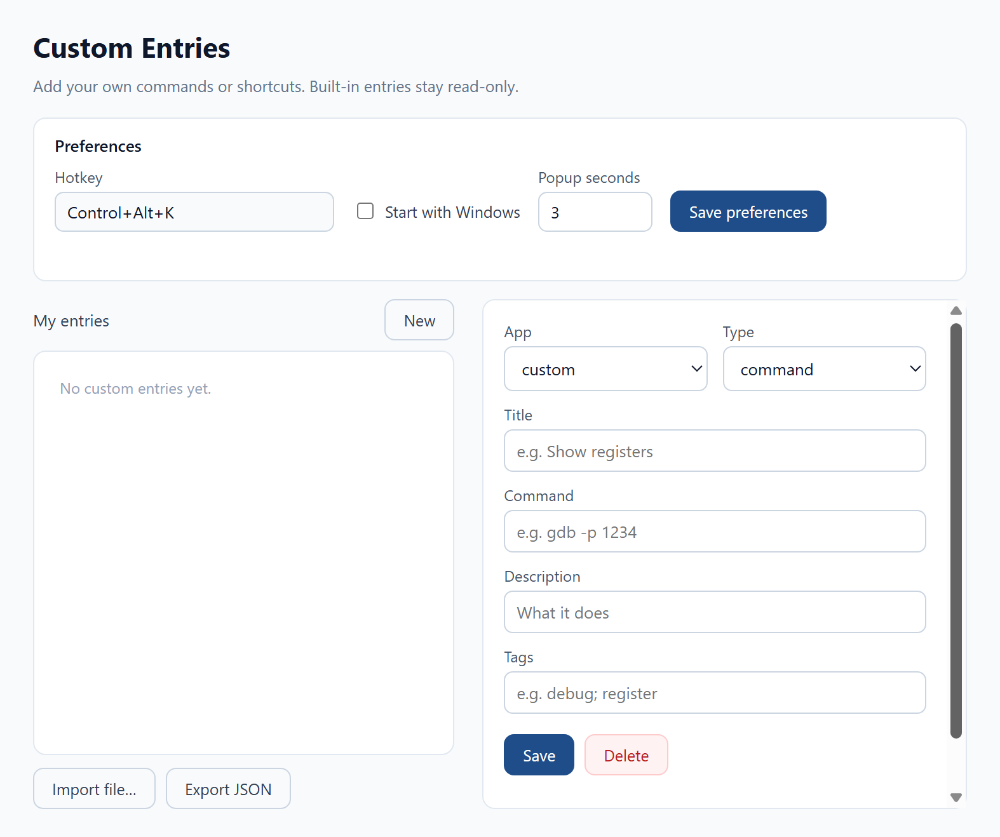

# Shortcut Launcher

> Windows 快捷键 / 命令速查器：`Ctrl+Alt+K` 呼出，输入即搜，命令自动复制，快捷键透明浮层提示。

[](LICENSE)
[](https://github.com/Neil-Wang-2085/shortcut-launcher/actions/workflows/build.yml)
[](https://marketplace.visualstudio.com/items?itemName=neilwang.shortcut-launcher)


内置 **250 条**快捷键与命令，覆盖 Office 三件套、Photoshop、Git、GDB、Windows、VS Code、Chrome/Edge、终端、CMake/Make、Outlook，**每条都有中文说明**。

## 截图

| Launcher | 命令补参 |
|---|---|
|  |  |

| 快捷键浮层 | 偏好设置 |
|---|---|
|  |  |

## 为什么做这个

- 中文快捷键资料分散在博客/表格里，且大多只有英文名
- 现有启动器偏「启动应用」，对「查快捷键、抄命令」支持一般
- 想要一个**离线、便携、带中文说明、能补命令参数**的小工具

## 特性

- **模糊搜索**：多词 AND、按键组合、拼写容错、中英混合、中文 bigram 匹配
- **命令即用**：命令结果回车直接复制；含 `<url>` / `<branch>` / `HEAD~N` 的会先弹出补参编辑条
- **快捷键浮层**：透明键帽展示，不抢焦点、鼠标穿透，自动消失（时长可配）
- **常用优先**：按使用次数 + 最近使用加权（frecency），越用越顺手
- **自定义条目**：表单添加，或导入 JSON / CSV / 文本
- **从网址导入**：设置页输入 URL，自动解析页面里的快捷键表格和命令
- **偏好设置**：全局热键（点击录制）、开机自启、浮层秒数
- **轻量常驻**：托盘、单实例、离线运行，提供便携版
- **中文说明**：250 条内置数据全部带中文描述

## VS Code 扩展

仓库内提供 VS Code 扩展（`vscode-extension/`），在编辑器里按 `Ctrl+Alt+S` 搜索同一套 250 条数据：

- 命令：复制到剪贴板，或一键「插入终端」
- 快捷键：打开键帽面板
- 状态栏入口：`⌨ Shortcuts`
- 自定义命令：搜索面板底部 **＋ 新增自定义命令…**，支持新增 / 编辑 / 删除
- **从文件夹批量导入**：命令面板 `Shortcut Launcher: Import Commands from Folder…`，给一个文件夹路径，自动扫描所有 JSON 并导入

安装（二选一）：

```bash
# 从 VS Code Marketplace
code --install-extension neilwang.shortcut-launcher

# 或从 Releases 下载 .vsix
code --install-extension shortcut-launcher-0.2.4.vsix
```

[Marketplace 页面](https://marketplace.visualstudio.com/items?itemName=neilwang.shortcut-launcher) · [扩展说明](vscode-extension/README.md)

## 下载

从 [Releases](https://github.com/Neil-Wang-2085/shortcut-launcher/releases) 下载：

- `ShortcutLauncher-x.y.z-portable.exe`：便携版，双击即用
- `Shortcut.Launcher.Setup.x.y.z.exe`：安装版（可选目录、桌面/开始菜单快捷方式）
- `shortcut-launcher-x.y.z.vsix`：VS Code 扩展

> 未做代码签名，首次运行可能触发 SmartScreen：点「更多信息 → 仍要运行」。介意可自行从源码构建。

数据目录：`%APPDATA%\shortcut-launcher\`

| 文件 | 用途 |
|---|---|
| `config.json` | 热键 / 开机自启 / 浮层时长 |
| `usage.json` | 使用次数与最近使用时间（frecency） |
| `user-entries.json` | 自定义条目 |

## 使用

- `Ctrl+Alt+K` 呼出/隐藏（可在设置里改；冲突时自动回退）
- `↑` `↓` 选择，`Enter` 执行，`Esc` 关闭
- 顶部 chips 按应用过滤

搜索语法：

| 输入 | 作用 |
|---|---|
| `word bold` | 多词 AND |
| `ctrl b` / `ctrl+b` | 按按键组合找 |
| `app:git rebase` | 限定应用 |
| `type:shortcut ctrl` | 只搜快捷键 |
| `tag:rebase` | 按标签过滤 |
| `冻结窗格` | 中文说明直接搜 |
| `git 改作者名字` | 中英混合 |

命令与快捷键：

- 命令：`Enter` 复制；带占位符时先补参；`Ctrl+E` 可编辑任意命令
- 快捷键：`Enter` 弹出键帽浮层

自定义条目：托盘 → **Custom Entries…**，或 launcher 底部 `⚙ Settings`。支持表单、JSON/CSV 文件导入、粘贴文本导入。

### 从网址导入（桌面版）

设置页 → **从网址导入**：

1. 输入网页地址，点「解析」
2. 自动提取表格里的快捷键、`<kbd>` 标记、代码块里的命令
3. 勾选需要的条目，点「导入选中」

> 只抓取静态 HTML；JS 渲染页面、登录页、内网地址、反爬页面可能解析不到。解析不到时，可复制页面里的表格/命令，用 **Bulk input** 粘贴导入。

## 内置数据（250 条）

| 分类 | 条数 | 覆盖 |
|---|---|---|
| Word / Excel / PPT | 20 / 21 / 17 | 格式、查找、导航 |
| Photoshop | 25 | 图层、变换、调色、滤镜 |
| Git | 36 | 提交、分支、变基、改作者、历史重写 |
| GDB | 31 | 断点、单步、栈、内存、寄存器、线程 |
| Windows | 18 | 桌面、窗口贴边、截图、剪贴板、任务管理器 |
| VS Code | 25 | 命令面板、搜索、编辑、调试 |
| Chrome / Edge | 19 | 标签、地址栏、DevTools、隐私 |
| Terminal | 20 | Windows Terminal 快捷键 + 常用 shell 命令 |
| 构建 | 8 | CMake / Make / Ninja / CTest |
| Outlook | 10 | 邮件、回复、日历 |

数据在 `src/shared/data/*.json`，中文说明在 `src/shared/zh-desc.ts`，中文别名在 `src/shared/zh-aliases.ts`。

## 从源码构建

要求：Node.js 22+、Windows 10/11。

```powershell
npm install
npm start        # 构建 renderer 并启动 Electron
npm test         # 35 项测试
npm run dist     # 生成 NSIS 安装包 + 便携版到 release/
```

国内网络可设置镜像：

```powershell
$env:ELECTRON_MIRROR = "https://npmmirror.com/mirrors/electron/"
$env:ELECTRON_BUILDER_BINARIES_MIRROR = "https://npmmirror.com/mirrors/electron-builder-binaries/"
```

## 项目结构

```
electron/          # 主进程、preload、三个窗口的 HTML
renderer/          # launcher / popup / settings 的 TS（esbuild 打包）
src/shared/        # 类型、归一化、搜索、存储、数据、中文别名/说明、网址解析
vscode-extension/  # VS Code 扩展（复用同一套数据与搜索）
scripts/           # 打包脚本、CLI 搜索、图标生成
tests/             # node:test 测试
docs/screenshots/  # README 截图
.github/workflows/ # CI：测试 + VSIX + 打 tag 自动发 Release
```

## 贡献

欢迎补数据、修 bug、提建议，见 [CONTRIBUTING.md](CONTRIBUTING.md)。

最需要的贡献：**补充你所在领域的快捷键/命令**（附官方文档链接），以及**中文说明的准确性**。

## 免责声明

- 本项目与 Microsoft、Adobe、Git、GDB 等无隶属关系
- 快捷键可能随软件版本、系统语言、键位布局变化，数据仅供参考
- 使用本工具造成的任何问题由使用者自行承担；软件按 MIT 协议「按原样」提供

## English

A Windows shortcut & command launcher with fuzzy search, Chinese descriptions, one-key command copy, and a transparent keycap overlay. 250 built-in entries across Office, Photoshop, Git, GDB, Windows, VS Code, Chrome/Edge, Terminal, CMake/Make, and Outlook. Also ships a VS Code extension with custom commands and folder-based JSON import. Electron + TypeScript, offline and portable. MIT licensed.

## License

[MIT](LICENSE) © 2026 Neil Wang
